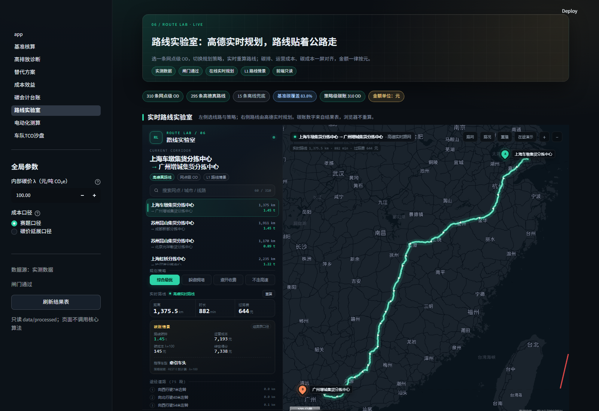
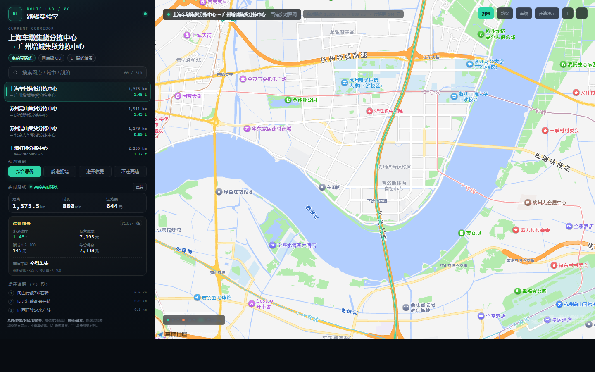
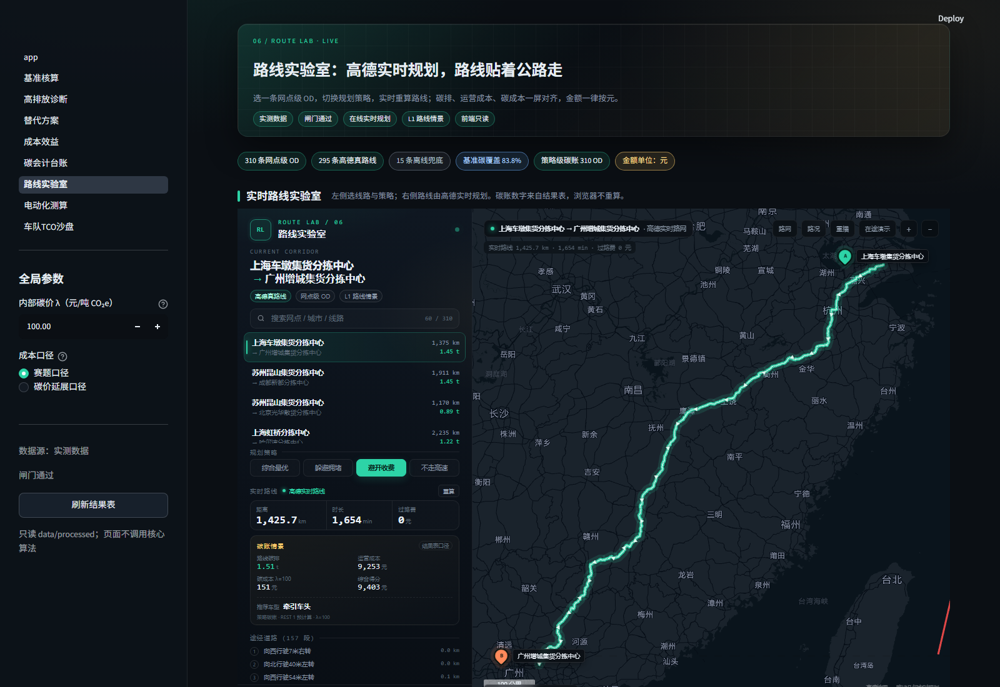

# 路线实验室：动态路线与视觉升级（2026-10-21）

**项目**：物流企业碳感知智能决策系统 ｜ **分支**：ZYX02 ｜ **页面**：第 6 页「路线实验室」
**关联**：docs/23（动态路线方案）、docs/24（JS API 嵌入）、docs/26（高德嵌入实施记录）、docs/20 §4/§11

---

## 0. 一句话

**路线不再是 400 个点抽稀出来的“抽象折线”，而是 AMap.Driving 实时返回的逐点路径（约 0.1 km 一点），带生长动画、镜头缓动、方向箭头和在途回放；碳账仍然只读结果表，金额一律按元。**

---

## 1. 问题：为什么看起来像折线

上一版 tools/route_fetch._simplify_polyline() 用固定步长抽样：

~~~python
step = max(1, len(chunks) // 400)
sampled = chunks[::step]          # 1,375 km 只留 400 点
~~~

实测上海车墩 → 广州增城：

| 口径 | 点数 | 平均点距 | 观感 |
|---|---:|---:|---|
| 高德原始路径 | **12,060** | 约 114 m | 贴着公路 |
| 旧缓存（400 点） | **400** | 约 3.4 km | 城市/山区直接跨过弯道，像折线 |
| 新 RDP（1,500 点上限） | **1,369** | 约 1.0 km | 保形，但仍只作为离线兜底 |

根因不是高德不贴路，而是**我们把高德返回的几何抽稀掉了**；同时第 6 页用这份缓存折线做主视觉，放大后自然“极其抽象”。

---

## 2. 方案：几何实时、碳账只读

| 层 | 谁负责 | 数据 | 是否业务计算 |
|---|---|---|---|
| 几何 / 距离 / 时长 / 过路费 | 高德 AMap.Driving（浏览器内） | 实时返回 routes[0].steps[].path | 否，只是路网资源 |
| 碳排 / 运营成本 / 碳成本 / 推荐车型 | 我们的结果表 | route_select.parquet | 是，已在 pipeline 算好 |
| L0 基准账 | 我们的结果表 | baseline_carbon.parquet | 永不动 |

**纪律没有破**：
- grep -R "from src" app/ 仍只有 services.py 的演算内核一行；
- 浏览器不出现碳因子、成本公式，不做乘加；
- 高德只回答“路怎么走”，不参与“走哪条、排多少碳、值不值”。

### 2.1 为什么用 JS Driving 而不是继续用预取 polyline

1. **贴合公路**：JS Driving 返回的 steps[].path 是渲染级几何，实测上海→广州 11,990 点；
2. **动态**：切换 OD / 规划策略（综合、避堵、避费、不走高速）时重新规划，路线和距离/时长/过路费实时变化；
3. **不增加仓库体积**：12,000 点/条 × 310 条若入库会到几十 MB；现在几何在浏览器侧现算，结果表仍只存业务指标；
4. **可降级**：无 key / 断网时页面回退离线缓存图（Plotly 或缓存折线），不会白屏。

### 2.2 与 docs/23“答辩现场零 API 调用”的关系

docs/23 的“零 API”约束的是**路线预取与业务结果表**，防的是答辩现场网络抖动导致页面卡死。
本次新增的是**在线地图增强层**：
- 有 key 且联网：JS Driving 实时规划，视觉最好；
- 无 key：route_lab() 返回 False，页面直接用离线缓存几何；
- 有 key 但断网：iframe 内 8–14 秒超时提示，回退缓存折线/端点，左侧碳账仍可读；
- 预取表 route_od.parquet、route_select.parquet 仍是业务口径的唯一来源，不因实时地图改变。

> 答辩建议：主演示用在线模式；断网演练走离线模式。两种模式都在页面标注“L1 路线情景”。

---

## 3. 视觉与交互（吸收 RouteBot demo 的设计）

第 6 页从“下拉框 + 一张图”升级为 **左侧控制台 + 右侧全幅地图**：

| 模块 | 设计 |
|---|---|
| 左侧线路列表 | 310 条网点级 OD，支持搜索；显示距离与碳排，选中项有 mint 轨道高亮 |
| 策略切换 | 综合最优 / 躲避拥堵 / 避开收费 / 不走高速（AMap.Driving policy 0/4/1/6） |
| 实时指标 | 距离、时长、过路费（元）随规划结果滚动刷新 |
| 碳账块 | 路线碳排（t）、运营成本（元）、碳成本（元，λ=100 缓存口径）、综合得分（元）、推荐车型 |
| 途经道路 | 高德 steps 的道路名 + 转向说明，最多 8 条，滚动 |
| 地图 | 高德 grey 暗色底图；路线三层描边（glow / 主线 / 高光）；方向箭头；A/B 脉冲钉 |
| 动画 | 路线 1.05 s 生长；setFitView 镜头缓动；数字 flash；在途车辆沿路径回放（16 s） |
| 工具 | 路网亮图切换、路况图层、重算、重播、在途演示、放大/缩小 |
| 底图 | 默认 amap://styles/grey：暗色但保留街道/POI/道路名；「路网」按钮切 normal 亮图，专门检查路线是否贴合道路 |
| 线宽 | 随缩放收窄：国家尺度 16/5 px，城市尺度 8/3.6 px，避免辉光盖住道路 |

### 3.1 关键动画实现

- **路线生长**：对全量路径按距离重采样到 640 点，逐帧 Polyline.setPath(sample.slice(0, n))，结束后回填全量几何；
- **镜头缓动**：map.setFitView(overlays, false, [90,90,90,90], 16)，高德内部缓动；
- **在途**：按累计 haversine 距离插值，Marker.setPosition + setAngle 沿路径移动，同时更新“已行驶/剩余”进度条；
- **方向箭头**：每约 55 km 取一个点，按前后点方位角旋转 ▲；
- **无障碍**：prefers-reduced-motion 下跳过生长动画。

---

## 4. 资金单位

路线页所有金额统一为 **元**：

- 过路费：元
- 运营成本：元
- 碳成本（λ=100 策略碳账）：元
- 综合得分：元
- 页面不出现 $ / 美元 / 万元（万元只保留在 TCO 汇总页，避免 5 位数过长）

> 碳成本、综合得分来自 route_candidate_carbon.parquet（缺失时回退 route_select.parquet），由 pipeline 以 λ=100 预计算；切换策略时几何与碳账同步更新，页面标注“策略碳账 · REST 1 预计算”。

---

## 5. 文件与接口

| 文件 | 变更 |
|---|---|
| app/components/route_lab_html.py | 新增：自包含 HTML/CSS/JS 模板（无 Streamlit 依赖，便于 Playwright 测试） |
| app/components/amapview.py | 重写：route_lab()（实验室）/ route_map()（紧凑图）/ key 与降级 |
| app/pages/6_路线实验室.py | 由 6_路线沙盘.py 重命名并重写 |
| app/pages/3_替代方案.py | 第 3 页入口文案改为“路线实验室” |
| app/services.py | 新增 route_lab_rows()（route_od + route_select）与 route_lab_candidates()（策略碳账） |
| app/components/mapview.py | 新增 route_preview()：离线控制台示意图（不画假底图） |
| app/components/theme.py | 新增 hero_compact()：给地图页留首屏高度 |
| tools/route_fetch.py | _simplify_polyline() 改为 RDP 保形抽稀（1500 点上限），新增 _rdp() |
| tools/route_candidates.py | 新增：310 OD × REST 策略 0/4/1/6，断点续跑，只存指标不存 polyline |
| src/optimizer.py | 抽出 _best_vehicle_for_route；新增 route_candidate_select()；build_routes 落候选碳账 |
| app/app.py / README.md | 导航与状态文案更新 |

### 5.1 浏览器契约（节选）

~~~json
{
  "id": "上海车墩集货分拣中心|广州增城集货分拣中心",
  "on": "上海车墩集货分拣中心",
  "dn": "广州增城集货分拣中心",
  "o": [121.315087, 31.014995],
  "d": [113.810734, 23.261452],
  "km": 1375.499, "min": 880.97, "toll": 644.0,
  "co2": 1.45, "opex": 7191.0, "cc": 145.0, "score": 7337.0,
  "veh": "牵引车头", "est": false,
  "cand": {
    "0": {"km": 1375.489, "co2": 1.452, "opex": 7193.23, "cc": 145.24, "score": 7338.47, "veh": "牵引车头"},
    "1": {"km": 1425.656, "co2": 1.505, "opex": 9252.51, "cc": 150.54, "score": 9403.06, "veh": "牵引车头"}
  }
}
~~~

- co2/opex/cc/score 全部来自结果表，前端不重算；
- 实时规划返回后只覆盖 km/min/toll 三个“路网指标”，碳账数字保持结果表口径并标注。

---

## 6. 验证记录（2026-10-21）

用 Playwright + 本机 Chrome，对独立组件与 Streamlit 页面各跑一遍：

| 项 | 结果 |
|---|---|
| 上海 → 广州默认路线 | 11,990 点，1,375.5 km，900 min，644 元 |
| 城市放大（上海车墩，z=14） | 路线沿沪昆高速/申嘉湖高速，不再跨路 |
| 亮图贴合检查（杭州 z=13） | 切「路网」后，路线沿杭州绕城高速、跨钱塘江桥面 |
| 策略“避开收费” | 1,425.7 km，约 1,650 min，0 元；18,196 点 |
| 策略“不走高速” | 1,425.7 km，约 1,650 min，0 元；18,196 点 |
| 在途演示 | 3.8 s 行驶 339 km，剩余 1,091 km，进度 24% |
| 策略碳账 | 切“避开收费”后碳排 1.51 t / 运营 9,253 元 / 碳成本 151 元 / 综合 9,403 元 |
| 策略碳账覆盖 | 310/310 OD × 4 策略 = 1,240 行，全部 amap_rest 真路线 |
| Streamlit iframe | __ROUTE_LAB__.ready=true，0 页面异常 |
| 无 key AppTest | 第 6 页回退 selectbox + 离线图，0 异常；第 3 页 0 异常 |
| RDP 自测 | 12,060 → 1,369 点；首尾点一致；0.112 s |

---

## 7. 运行与配置

1. 在 config/amap_js_key.txt 放 **Web 端（JS API）key**；
2. 在 config/amap_js_code.txt 放 **securityJsCode**；
3. 高德控制台域名白名单至少包含 localhost:8501 与答辩机地址；
4. 重启 Streamlit，侧边栏 →「路线实验室」；
5. 无 key 时页面自动走离线模式，不会报错。

~~~bash
streamlit run app/app.py
# 或
python -m tools.launch
~~~

---

## 8. 策略级碳账：候选路线 × 4 策略（2026-10-21 追加）

第一版切换策略只换几何，碳账仍停在“综合策略缓存”。本轮补上：

### 8.1 数据链路

~~~text
工具：tools/route_candidates.py
  310 个 OD × REST strategy 0/4/1/6
  → data/processed/route_candidates.parquet

引擎：src/optimizer.route_candidate_select()
  同一 OD 的段子集 + 每条候选路线
  → 复用 _best_vehicle_for_route（与 route_select 完全同口径）
  → data/processed/route_candidate_carbon.parquet（OD × 策略 × 车型）

前端：app/services.route_lab_candidates()
  od_key → {strategy: {km,min,toll,co2,opex,cc,score,veh}}
  → 注入 route_lab 的 payload.cand
~~~

### 8.2 策略映射

| Pill | JS policy（实时几何） | REST strategy（预计算碳账） |
|---|---:|---:|
| 综合最优 | 0 | 0 |
| 躲避拥堵 | 4 | 4 |
| 避开收费 | 1 | 1 |
| 不走高速 | 6 | 6 |

两套接口对同一策略分别请求；REST 与 JS 的距离/时长可能差几个百分点，
页面同时展示“实时几何”与“同策略预计算碳账”，不把两者混算。

### 8.3 切换策略后的实际效果（上海 → 广州）

| 策略 | 实时里程 | 实时时长 | 过路费 | 碳排 | 运营成本 | 碳成本 λ=100 | 综合得分 |
|---|---:|---:|---:|---:|---:|---:|---:|
| 综合 0 | 1,375.5 km | 约 881 min | 644 元 | 1.45 t | 7,193 元 | 145 元 | 7,338 元 |
| 避开收费 1 | 1,425.7 km | 约 1,648 min | 0 元 | **1.51 t** | **9,253 元** | **151 元** | **9,403 元** |

碳账不再停在 1.45 t/7,193 元，而是随策略切换；页面左下角同步显示
“策略碳账 · REST 1 预计算 · λ=100”。

> 同一 OD 的策略路线可能重合：例如当前无拥堵时“躲避拥堵”与“综合”返回同一条路，
> 表内数值相同属于真实路网结果，不代表没有切换。

### 8.4 边界

- 候选碳账是 **L2 展示口径**，不覆盖 L0 基准 E₀，也不进闸门；
- λ 固定 100（与 route_select 一致），改 λ 需重跑 pipeline；
- 若某 OD 的候选缺失，前端自动回退“综合策略缓存”并黄字提示；
- 候选路线只存指标，不存 polyline；实时几何仍由 JS Driving 提供；
- 候选 0 与 route_select 默认路线来自不同批次/接口，个别 OD 的里程会有差异；
  页面并排展示时以“策略碳账”表为准，路线账本保留 route_select 默认口径并注明。

### 8.5 数据落库

全量预取结果：**1,240 行 = 310 OD × 4 策略，全部 amap_rest 真路线**；
候选碳账 **1,240 行（OD × 策略 × 车型）**，4 个策略各 310 个 OD。
`route_candidate_carbon.parquet` 与 `route_candidates.parquet` 随分支入库，
方便没有 key 的机器直接打开页面看策略碳账。

---

## 9. 已知边界与下一步

| 边界 | 处理 |
|---|---|
| 策略碳账 | 已由 route_candidates × route_candidate_carbon 提供；某 OD 缺候选时回退综合策略缓存并黄字提示 |
| 在线模式依赖网络与 key | 三层降级：实时 → 缓存折线 → 端点；左侧碳账与路线账本始终可读 |
| 高德货车规划需商务合同 | 仍用 Driving + 自有 C1–C5 约束，不改范围 |
| 缓存 polyline 仍是 400 点 | 本页主视觉已改用实时几何；重跑 tools.route_fetch 会按 RDP 生成更保形的缓存（离线兜底用） |
| 高德底图在部分网络下瓦片失败 | 路线几何/指标仍可用；页面有错误提示，不白屏 |

> 下一步优先级：拖拽改线（DragRoute）> 货车规划商务工单 > 候选路线按实时路况重算。
> 候选路线预计算与策略级碳账已于 2026-10-21 落地（见 §8）。
