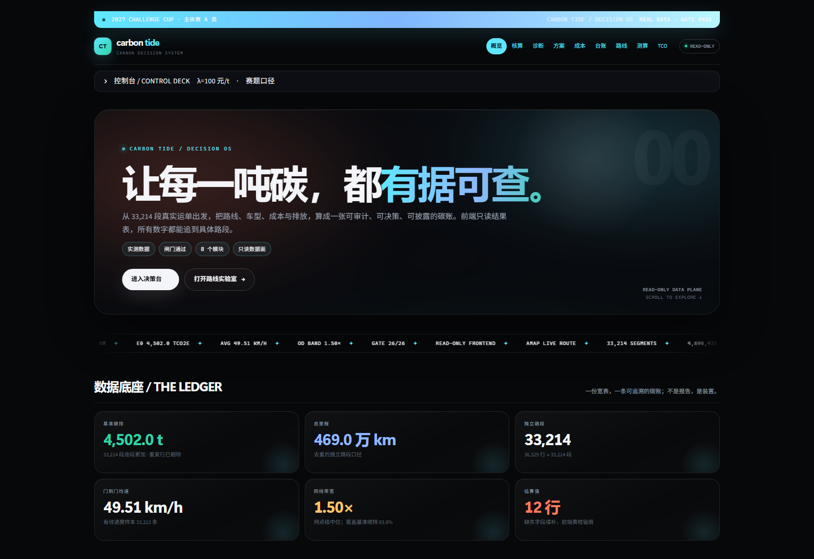
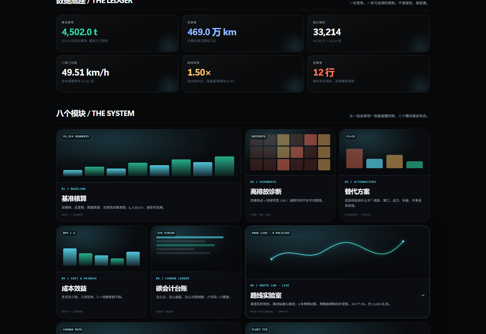
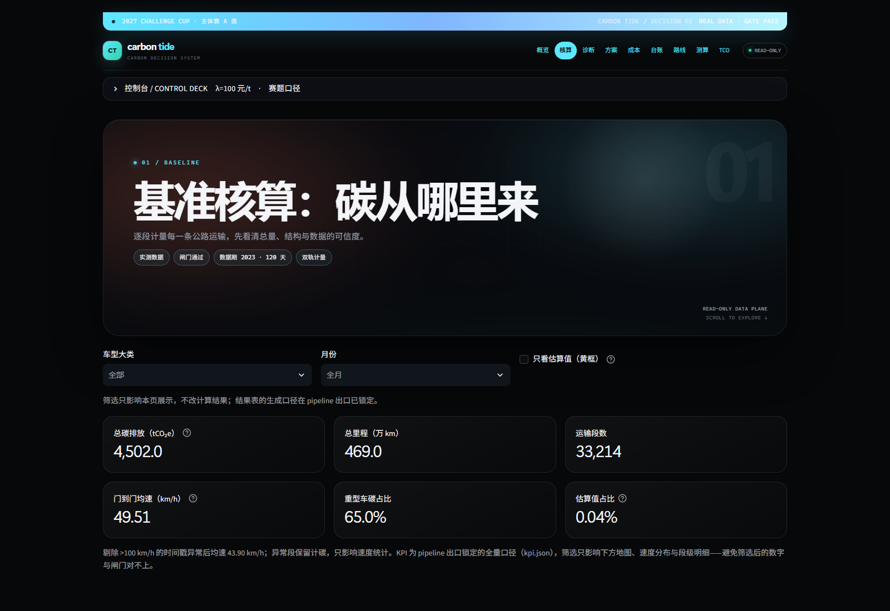
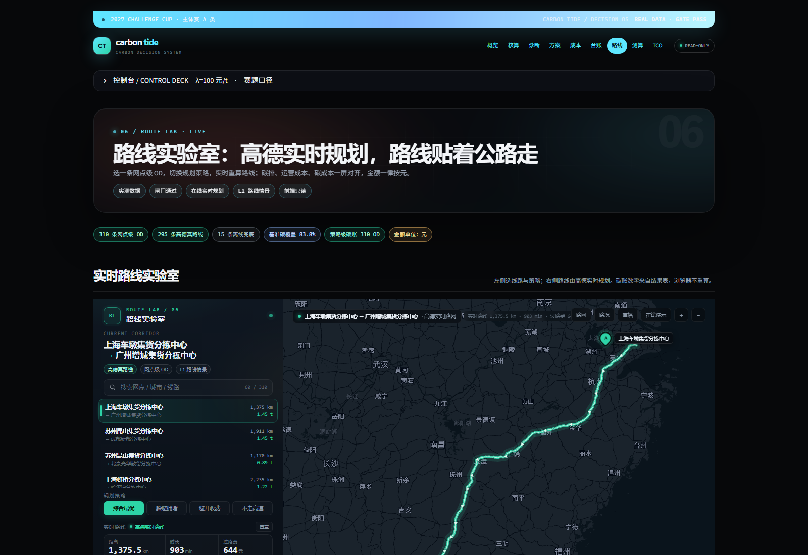
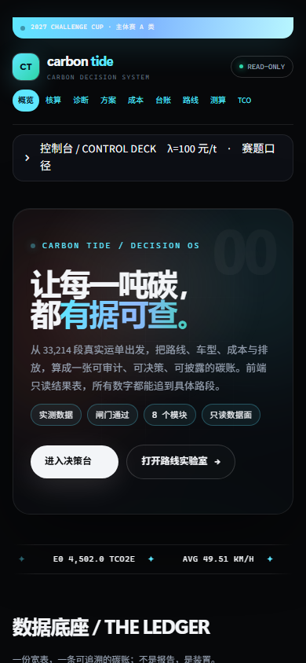

# 前端重设计：Carbon Tide 电影感数据驾驶舱

**日期**：2026-10-22  
**范围**：只改展示层，不改数据、引擎、闸门与任何业务口径。  
**参考**：https://www.scrolltide.co/ 的视觉语言，而不是复制它的业务布局。

---

## 1. 从 Scrolltide 拆出来的六件事

| 设计特征 | Scrolltide 的做法 | 本项目落地 |
|---|---|---|
| 暗色电影底 | #07080A 近黑 + 橙/蓝双色环境光 | 全局 radial-gradient 底 + 潮汐青 #5EE7FF |
| 超大展示字 | 88px Bricolage Grotesque，紧字距 | 76/64px 系统展示字，长标题自动降档防断行 |
| 潮汐渐变 | 白字 + 青蓝渐变关键词 | “有据可查”等关键词走青蓝渐变 |
| 玻璃卡片 | 大圆角、细边框、低对比底 | 指标卡 / bento / 表格 / 控制台统一 18–30px 圆角 |
| 横向数据带 | 技术栈 marquee | 33,214 段 / 4.69M km / E₀ / GATE 26/26 数据 marquee |
| 滚动叙事 | 全屏 hero + 大分区 | 首页 hero → 数据底座 → 八模块 bento → 流程 → 运行状态 → CTA |

没有引入任何外部字体、图片、视频或 JS 库；所有光晕、网格、噪点、路线示意都是 CSS/内联 SVG。断网仍然可渲染。

---

## 2. 页面结构

- **顶部公告条**：赛事、数据源、闸门状态。
- **顶部导航**：概览 / 核算 / 诊断 / 方案 / 成本 / 台账 / 路线 / 测算 / TCO，替代原来的侧栏页面列表。
- **控制台**：λ、成本口径、刷新、数据/闸门状态，收进顶部可折叠条；移动端不再挤压主内容。
- **首页**：电影感 hero + 数据 marquee + 六张指标卡 + 八模块 bento + 四步管线 + 运行状态。
- **第 1–8 页**：统一 hero、章节、卡片、表格、图表配色；原有功能、筛选、下载、路线实验室、计算器全部保留。

页面截图：

---

## 3. 只读纪律

- 页面只通过 app/services.py 读 data/processed/*.parquet 与 JSON。
- 不调用 src.optimizer、src.evaluator、src.scenarios 做业务计算。
- 页面内只做行选取、单位换算、格式化与展示级排序；不新增碳账/成本算法。
- λ 只改变第 3–5 页的展示换算，不写回结果表。
- 空表/缺 key/演示数据都只提示，不红屏；闸门和披露数字仍来自 pipeline 出口。

---

## 4. 代码位置

| 文件 | 作用 |
|---|---|
| app/components/theme.py | 全局 CSS、顶部导航、hero、marquee、CTA、色彩/字体 token |
| app/components/layout.py | 页面配置、控制台、指标卡、章节、结论带 |
| app/app.py | 首页 hero / 数据底座 / 八模块 bento / 运行状态 |
| app/components/charts.py | Plotly 配色与标题/图例间距 |
| app/components/calcpanel.py、mapview.py | 计算器与离线地图配色同步 |
| .streamlit/config.toml | Streamlit 原生暗色主题 token |

---

## 5. 验证

- pytest -q tests/：**12 passed**（含首页 + 8 页 AppTest）。
- Playwright 1600×1100、1366×900、390×844：无横向溢出；移动端无侧栏遮挡。
- 顶部导航、bento 卡片：点击后正确跳转（自定义 <a> 加 target="_top"，绕开 Streamlit 对普通锚点的拦截）。
- 控制台展开后改 λ=200：第 4 页当前 λ、图表、表格同步刷新。
- 路线实验室：约 18 秒后 __ROUTE_LAB__.ready，实时 11,990 点，4 策略碳账正常。
- 没有 use_container_width / st.components.v1.html / 外部 @import。

---

## 6. 已知边界

- 顶部导航目前是静态 bar，不是 Scrolltide 那种吸顶导航；避免在 Streamlit 主滚动容器里做 fixed 定位导致内容遮挡。
- 路线实验室的地图仍是高德 grey 亮图，和暗色外壳形成刻意反差；路线本身为青色。
- 截图来自 2026-10-22 本机真实数据模式；演示模式会出现黄条提示。
