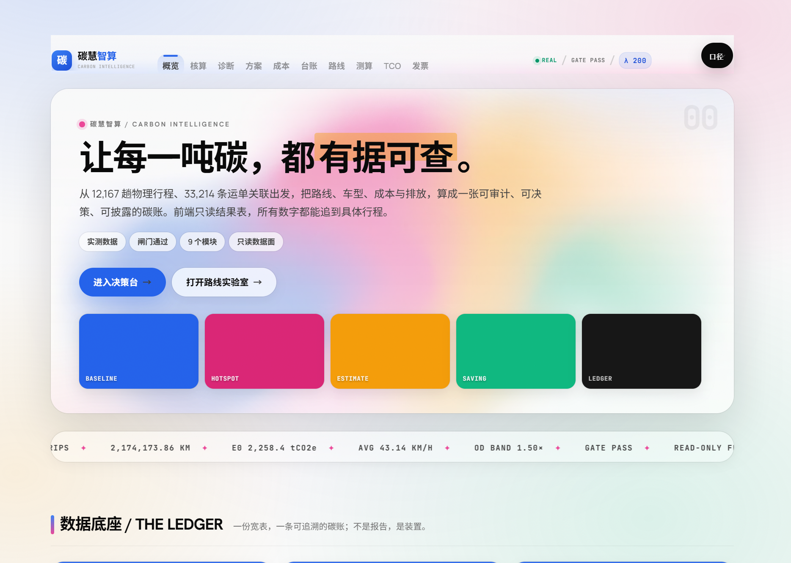
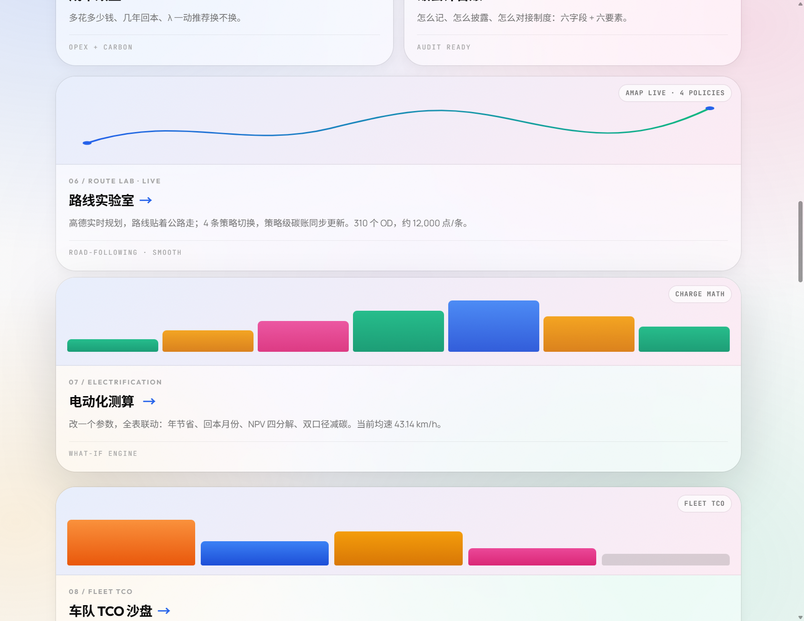
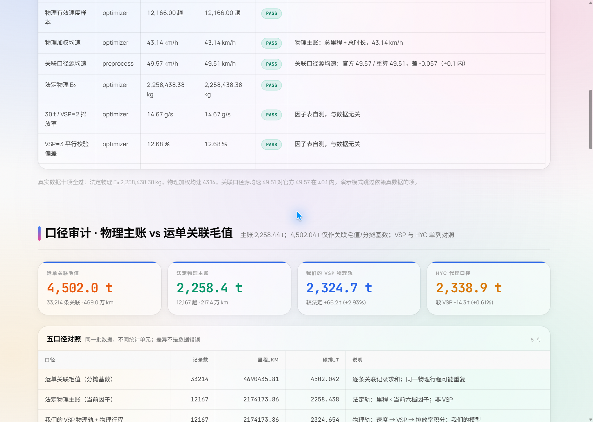
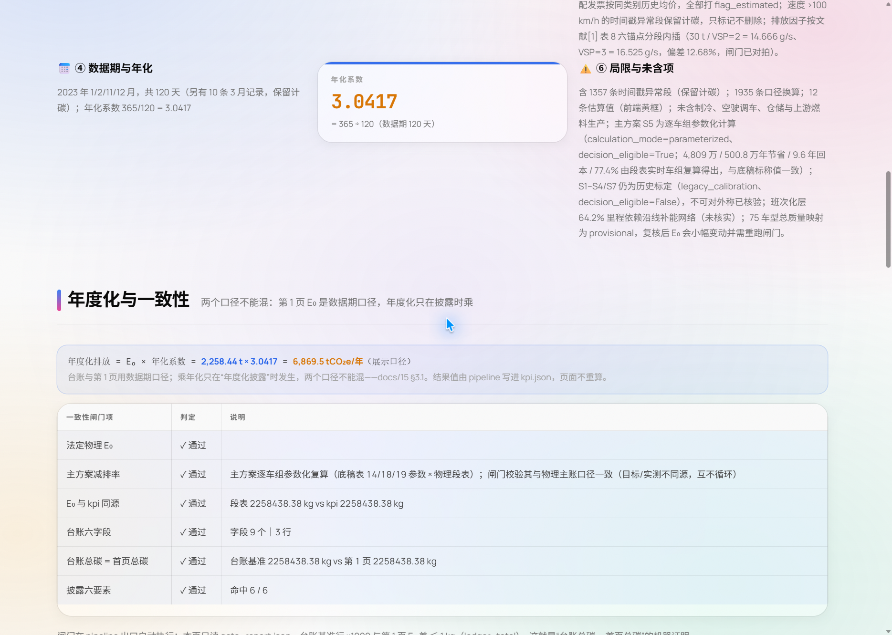
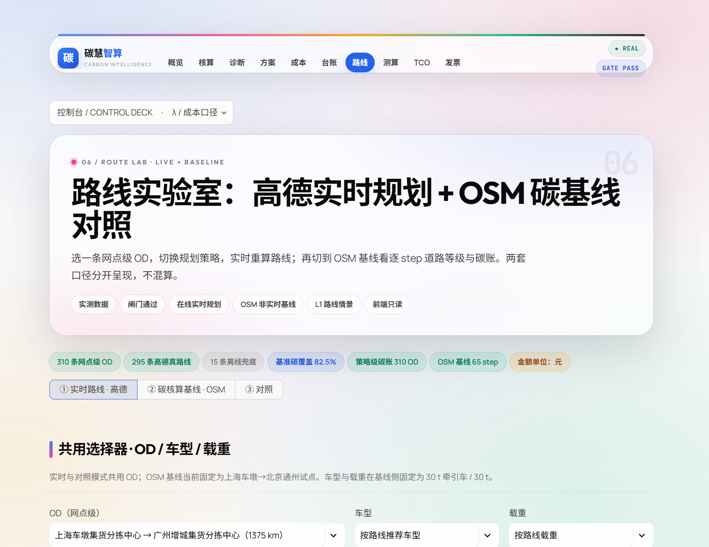
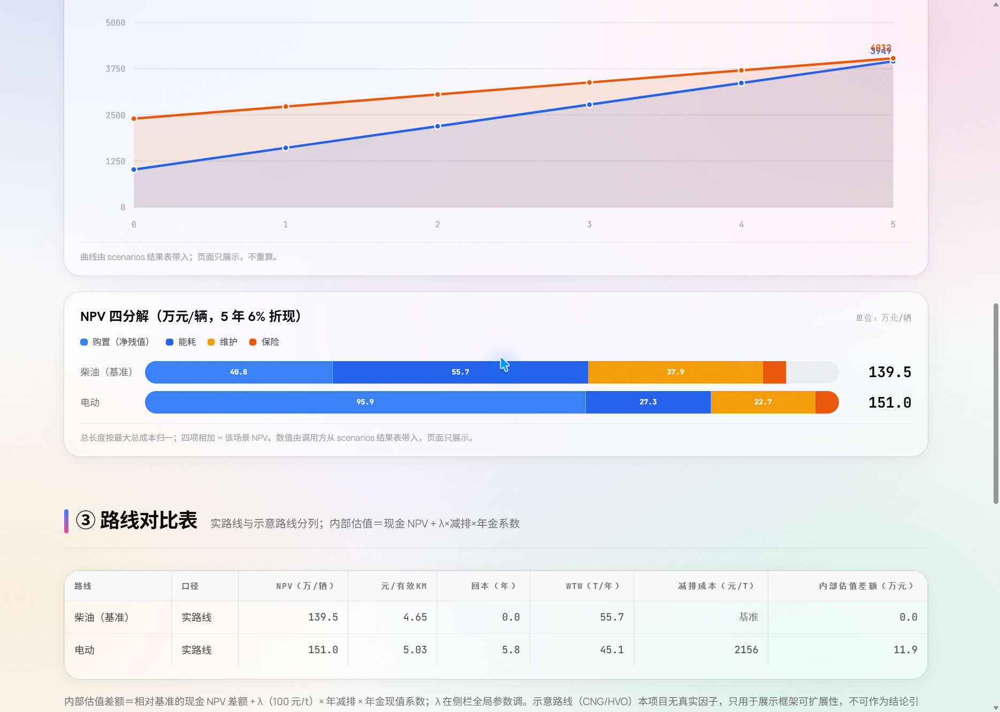

# 前端重设计：Coolors Palette 浅色玻璃驾驶舱

**日期**：2026-10-26
**范围**：只改展示层（视觉、组件皮肤、交互反馈）。业务计算、口径、引擎、时门与数据管线**零改动**。
**参考**：https://coolors.co/ ——逆向拆解其实际样式表 `https://coolors.co/assets/css/dist/style.min.css`
（本地留存：`D:\oceanbase01\_reverse\style.min.css`，1,196,416 字节，minified）。
**上一版**：`docs/30_前端重设计_CarbonTide.md`（暗色电影感 Carbon Tide），本文档取代其视觉部分，但**不取代**它的业务说明。

> 这份文档的定位是「换视觉时不要重新发明」的施工说明：令牌在哪、类名依赖谁、哪些东西不能碰。
> 文档里出现的每一个色值、圆角、阴影、缓动都取自 `app/components/theme.py` 的实际 CSS 变量，不是设计稿。

---

## 1. 设计来源与逆向拆解

本项目的视觉有两个来源，分工明确：

| 来源 | 负责什么 | 怎么拆的 |
|---|---|---|
| **https://coolors.co/** | 色彩系统、色板条、卡片/表格/按钮的形态 | 读它的产物样式表，抽取重复出现的字面量（见 1.1） |
| **https://threejs-journey.com/** | 顶栏（导航 + 字体） | 读它的 `index.css` 与 DOM：`.link .highlight` 的高亮机制、header 无容器、状态纯文字、CTA 药丸；字体是 `Greycliff CF`（商用）→ 用同族免费字体 Hanken Grotesk 替代 |

### 1.1 拆解方法

coolors.co 没有公开的设计 token 文档，所以直接读它的产物样式表，抽取**在多处重复出现的具体字面量**，再反推设计系统：色彩靠统计全部 `--color-*` 变量定义（拿到 neutral / primary / pink 三条完整色阶）；「无边界」靠搜 `box-shadow` 里 `0 0 0 1px` 的用法（发现它同时承担「描边」和「焦点环」两个职能）；圆角靠统计 `border-radius` 字面量频次（取高频值而非个例）；动效靠统计 `cubic-bezier(...)` 的去重集合；玻璃靠搜 `backdrop-filter` 的模糊量级。

结论：coolors 的视觉语言可以压缩成四句话——**浅灰底 + 大色块 + 无边框 + 大扩散柔影**。

### 1.2 令牌映射表（coolors 原生 → 本系统）

| coolors 令牌 | 字面量 | 本系统变量 | 本系统字面量 | 说明 |
|---|---|---|---|---|
| `--color-neutral-50` | `#fafafa` | `--ct-canvas` | `#FAFAFA` | 全站画布底 |
| `--color-white` | `#ffffff` | `--ct-surface` | `#FFFFFF` | 不透明表面（表头、代码块、展开面板） |
| `--color-neutral-950` | `#0a0a0a` | `--ct-ink` | `#0A0A0A` | 主文字 |
| `--color-neutral-700` | `#404040` | `--ct-ink-2` | `#404040` | 正文 |
| `--color-neutral-500` | `#737373` | `--ct-ink-3` | `#737373` | 次要说明 |
| `--color-neutral-400` | `#a3a3a3` | `--ct-ink-4` | `#A3A3A3` | 弱化文字 / 已去重语义 |
| `--color-primary-600` | `#2563eb` | `--ct-blue` | `#2563EB` | 品牌蓝 = 系统 / 数据 |
| `--color-primary-500` | `#3b82f6` | `--ct-blue-500` | `#3B82F6` | 亮一档的蓝（卡片顶条、渐变起点） |
| `--color-primary-700` | `#1d4ed8` | `--ct-blue-700` | `#1D4ED8` | 按下态 / 深字 |
| `--color-primary-50` | `#eff6ff` | `--ct-blue-tint` | `#EFF6FF` | 选中步骤底色 |
| `--color-pink-600` | `#db2777` | `--ct-pink` | `#DB2777` | 强调粉 = 热点 / 高排放 |
| `--color-pink-500` | `#ec4899` | `--ct-pink-500` | `#EC4899` | 亮粉（kicker 圆点、渐变终点） |
| `--color-pink-50` | `#fdf2f8` | `--ct-pink-tint` | `#FDF2F8` | 粉色浅底 |
| `--border-transparent-color` | `rgba(0,0,0,.07)` | `--ct-ring` | `rgba(10,10,10,.07)` | 发丝环 |
| `--border-transparent-color-2` | `rgba(0,0,0,.1)` | `--ct-ring-2` | `rgba(10,10,10,.12)` | 环（略重，滚动条 hover / 分隔） |
| `--border-transparent-color-3` | `rgba(0,0,0,.15)` | `--ct-ring-3` | `rgba(10,10,10,.18)` | 环（最重） |
| `input--m` / `input--l` / `input--s` | `10px / 14px / 8px` | `--ct-r-sm` / `--ct-r` / `--ct-r-xs` | `10px / 14px / 8px` | 原样沿用 |
| 胶囊按钮 / 标签 | `100px` | `--ct-r-pill` | `100px` | 原样沿用 |
| 大扩散柔影 | `0 8px 48px rgba(0,0,0,.15)` | `--ct-shadow` | `0 8px 48px rgba(10,10,10,.10), 0 0 0 1px var(--ct-ring)` | 扩散部分**降一档**（环是本系统追加的），见 §1.3 / §1.4 |
| 缓动 | `cubic-bezier(0.3, 0.4, 0, 1)` | `--ct-ease` | `cubic-bezier(.3,.4,0,1)` | 原样沿用 |
| 缓动（次） | `cubic-bezier(0.6, 0.4, 0, 1)` | `--ct-ease-2` | `cubic-bezier(.6,.4,0,1)` | 原样沿用 |
| `backdrop-filter` | `blur(5px)` | `--ct-blur` / `-sm` / `-lg` | `blur(22px) saturate(180%)` / `blur(12px) saturate(160%)` / `blur(40px) saturate(200%)` | **放大约 4 倍**，见 §1.4 |
| 大色块马赛克 | `.visualizer-design .btn` 等色板结构 | `.cm-palette` | — | 改造成 Hero 内的色板条 |

### 1.3 coolors 的「无边界」实现手法（本系统沿用）

coolors 的卡片**没有 `border`**，边界完全由 `box-shadow` 画出来：

```css
/* coolors 原生：透明色 + 发丝环 */
box-shadow: hsla(250, 3%, 0%, 0.075) 0 0 0 1px;
box-shadow: hsl(216, 100%, 50%) 0 0 0 1px;   /* 聚焦态换成主色环 */
```

两个关键点：

1. **环的颜色和阴影扩散色解耦**。环用半透明黑，扩散用 `rgba(0,0,0,.05)` 一类的浅影，二者可以独立调。
2. **`0 0 0 1px` 是零偏移零模糊的实心描边**，但因为它在 `box-shadow` 里而不是 `border` 里，所以它**不占布局尺寸**——这正是卡片能自由换圆角、换背景、换内边距而不发生 1px 抖动的原因。

本系统沿用同一手法，令牌层面对应关系：

```css
--ct-ring: rgba(10,10,10,.07);              /* 等价 coolors hsla(250,3%,0%,.075) */
--ct-shadow: 0 8px 48px rgba(10,10,10,.10), 0 0 0 1px var(--ct-ring);
```

即：**每一档阴影都自带发丝环**。写新组件时，不要加 `border`，要加 `box-shadow: 0 0 0 1px var(--ct-ring)`（或直接复用 `--ct-shadow-*` 档位）。

### 1.4 两处有意偏离

| 项 | coolors 原值 | 本系统取值 | 理由 |
|---|---|---|---|
| 大扩散柔影 | `rgba(0,0,0,.15)` | `rgba(10,10,10,.10)` | coolors 的 .15 出现在浮动 cookie 横幅上，只有一层。驾驶舱里同屏叠 5+ 张玻璃卡，.15 会糊成一片黑边 |
| 模糊量级 | `blur(5px)` | `blur(22px) saturate(180%)` | 5px 几乎看不出玻璃。我们画布底是彩色径向渐变 + 噪点，模糊必须够强才能把底下的光晕揉开；同时补 `saturate()`，否则透过玻璃的色彩会发灰 |

另外 coolors 的 `border-radius:15px` 只出现 6 次（游标、chip），频率低于 `10px`(162) 与 `14px`(104)。我们把 15px 归一到 `--ct-r`(14px)，另设 `--ct-r-xl:28px` 服务 Hero / Bento 卡——这一档是本系统自有的，不来自 coolors。

---

## 2. 设计令牌表

令牌**只有一个真源**：`app/components/theme.py` 的 `:root` 块（CSS 字符串开头）。CSS 与 Python 组件共用同一套语义，Python 侧常量 `PALETTE` 与 CSS 令牌保持手工同步。

> **命名约定**：CSS **变量**用 `--ct-` 前缀；CSS **类名**用 `cm-` 前缀。两者不是一回事，不要混用。

### 2.1 画布与墨色

| 变量 | 值 | 用途 |
|---|---|---|
| `--ct-canvas` | `#FAFAFA` | 页面底色；表头底、滚动条轨道 |
| `--ct-surface` | `#FFFFFF` | 不透明表面：`stDataFrame`、代码块、选中 tab、输入框 |
| `--ct-ink` | `#0A0A0A` | 主标题、主数字、强调文字 |
| `--ct-ink-2` | `#404040` | 正文 |
| `--ct-ink-3` | `#737373` | 次要说明、表格内容 |
| `--ct-ink-4` | `#A3A3A3` | 弱化文字；**同时是「已去重」语义色** |

### 2.2 品牌色

| 变量 | 值 | 用途 |
|---|---|---|
| `--ct-blue` | `#2563EB` | 品牌主色：主按钮、选中导航、焦点环、图表主色 |
| `--ct-blue-500` | `#3B82F6` | 卡片顶条、渐变起点 |
| `--ct-blue-700` | `#1D4ED8` | 主按钮按下态、深色文字 |
| `--ct-blue-tint` | `#EFF6FF` | 选中步骤底、原生 page_link 禁用态 |
| `--ct-pink` | `#DB2777` | 强调粉：热点 |
| `--ct-pink-500` | `#EC4899` | kicker 圆点、分区标题渐变终点 |
| `--ct-pink-tint` | `#FDF2F8` | 粉色浅底 |

### 2.3 业务语义色

全站只允许 6 种语义色，**看颜色就知道这一行/这一格是什么意思**。

| 语义 | 主色 | 变量 | 浅底 | 文字 |
|---|---|---|---|---|
| 达标 / 闸门通过 | 绿 | `--ct-mint` `#059669` | `--ct-mint-tint` `#ECFDF5` | `--ct-mint-500` `#10B981` |
| 系统 / 数据 | 蓝 | `--ct-blue` `#2563EB` | `--ct-blue-tint` `#EFF6FF` | `--ct-blue-500` `#3B82F6` |
| 估算 / 需复核 | 橙 | `--ct-amber` `#D97706` | `--ct-amber-tint` `#FFFBEB` | `--ct-amber-500` `#F59E0B` |
| 高排放 / 热点 | 橙红 | `--ct-coral` `#EA580C` | `--ct-coral-tint` `#FFF7ED` | `--ct-coral` `#EA580C` |
| 未通过 / 冲突 | 红 | `--ct-red` `#DC2626` | — | `#DC2626` |
| 已去重 | 灰 | `--ct-ink-4` `#A3A3A3` | — | `#A3A3A3` |

辅助语义色：`--ct-violet` `#7C3AED`（画布氛围光）、`--ct-cyan` `#0891B2`（备用）。

`--ct-accent` 是**局部变量**：`.cm-stat` 通过 `.tone-mint / .tone-info / .tone-amber / .tone-coral / .tone-pink / .tone-plain` 覆写它，顶部 3px 色条读取 `var(--ct-accent, var(--ct-blue))`。新指标卡请复用 tone 体系，不要新造颜色。

### 2.4 圆角

| 变量 | 值 | 用在哪 |
|---|---|---|
| `--ct-r-xs` | `8px` | 小控件 |
| `--ct-r-sm` | `10px` | 输入框、`.cm-demo`、`.cm-empty` |
| `--ct-r` | `14px` | 常规卡片、色板条、公式块、结论带 |
| `--ct-r-lg` | `20px` | 指标卡、面板、数据台账、图表容器 |
| `--ct-r-xl` | `28px` | Hero、Bento 卡、CTA、顶栏 |
| `--ct-r-pill` | `100px` | 所有胶囊：导航、芯片、按钮、进度条、状态徽标 |

### 2.5 阴影

| 变量 | 值 | 用在哪 |
|---|---|---|
| `--ct-shadow-xs` | `0 1px 3px rgba(10,10,10,.04), 0 0 0 1px var(--ct-ring)` | 轻元素、`stAlert`、代码块、选中 tab |
| `--ct-shadow-sm` | `0 4px 16px rgba(10,10,10,.05), 0 0 0 1px var(--ct-ring)` | 面板、指标卡、台账、展开器 |
| `--ct-shadow` | `0 8px 48px rgba(10,10,10,.10), 0 0 0 1px var(--ct-ring)` | 顶栏、结论带、大卡 |
| `--ct-shadow-lg` | `0 24px 70px rgba(10,10,10,.14), 0 0 0 1px var(--ct-ring)` | Hero、CTA、Bento hover |
| `--ct-shadow-blue` | `0 10px 30px rgba(37,99,235,.22)` | 主按钮、选中导航（彩色影，不带环） |
| `--ct-shadow-pink` | `0 10px 30px rgba(219,39,119,.20)` | 强调元素 |

**规则：阴影档位自带动作层级。** 内容区元素用 `-sm`，浮起/吸顶用 `-`，页面级用 `-lg`。不要在组件里写裸 `box-shadow`（除发丝环例外），一律引变量。

### 2.6 玻璃

| 变量 | 值 | 用在哪 |
|---|---|---|
| `--ct-glass` | `rgba(255,255,255,.62)` | 面板、指标卡、台账、展开器 |
| `--ct-glass-2` | `rgba(255,255,255,.78)` | 顶栏、Hero、结论带 |
| `--ct-glass-3` | `rgba(255,255,255,.90)` | 弹层（popover 面板） |
| `--ct-blur` | `blur(22px) saturate(180%)` | 默认玻璃 |
| `--ct-blur-sm` | `blur(12px) saturate(160%)` | 次级玻璃（ghost 按钮、步骤卡） |
| `--ct-blur-lg` | `blur(40px) saturate(200%)` | Hero |

> `backdrop-filter` 必须同时写 `-webkit-backdrop-filter`（Safari / 部分 Chromium 版本需要）。项目里所有玻璃块都成对写了，新增时照抄。

### 2.7 缓动与时长

| 变量 | 值 |
|---|---|
| `--ct-ease` | `cubic-bezier(.3,.4,0,1)` |
| `--ct-ease-2` | `cubic-bezier(.6,.4,0,1)` |
| `--ct-fast` | `180ms` |
| `--ct-mid` | `340ms` |
| `--ct-slow` | `640ms` |

入场动画用 `cm-rise`（位移 + 淡入，`--ct-slow` + `--ct-ease`），色板条用 `cm-grow`（纵向生长），marquee 用 `cm-slide`。`prefers-reduced-motion: reduce` 下全部动画降到 0.001ms。

### 2.8 字体

| 角色 | 变量 | 栈 |
|---|---|---|
| 展示（标题） | `--ct-font-display` | `'Hanken Grotesk','Noto Sans SC','PingFang SC','Microsoft YaHei',sans-serif` |
| 正文 | `--ct-font-body` | `'Manrope','Noto Sans SC','PingFang SC','Microsoft YaHei',sans-serif` |
| 数字 / 代码 | `--ct-font-mono` | `'JetBrains Mono',ui-monospace,'SFMono-Regular',Consolas,monospace` |

中文一律落在 `Noto Sans SC` → `PingFang SC` → `Microsoft YaHei`，保证 Windows / macOS 都有像样的回退。

> **为什么是 Hanken Grotesk**：顶栏与标题的视觉参考是 https://threejs-journey.com/，它用的是商用字体 **Greycliff CF**（`/bundles/public/index.css` 里 `@font-face` + `font-family:Greycliff`）。Greycliff 不可商用再分发，Hanken Grotesk 是同族替代（neo-grotesque、大 x 高度、方终端、字腔紧），字面气质对得上，且在 Google Fonts 上可免费取用。断网回落见 §6。

**数字排版纪律**：所有数字必须 `font-variant-numeric: tabular-nums`。理由是对拍表格——碳核算页面大量并列多行数字，非等宽数字会让小数点上下错位。`.cm-num` 类、`.cm-stat .v`、`.cm-htable`、`.cm-kv td.v`、`.cm-npv-total` 都已设。Plotly 没有这个选项，用 CSS 补：`.js-plotly-plot text{ font-variant-numeric:tabular-nums; }`。

### 2.9 与 Streamlit 原生主题的同步

`.streamlit/config.toml` 必须与令牌一致，否则首帧（CSS 注入前）会闪一下旧主题：`base = "light"`、`primaryColor = "#2563EB"`、`backgroundColor = "#FAFAFA"`、`secondaryBackgroundColor = "#FFFFFF"`、`textColor = "#0A0A0A"`、`font = "sans serif"`。

---

## 3. 组件规范

### 3.1 顶栏（`st.container(key="cm_header_card")`）

顶栏的视觉参考是 **https://threejs-journey.com/**，把它的三条设计语言搬过来：

| threejs-journey | 本系统落地 |
|---|---|
| header 无容器：没有圆角、没有描边、没有投影，就是一层薄渐隐遮罩贴在画布上 | `border-radius:0 !important; box-shadow:none !important;` + `linear-gradient(180deg, rgba(250,250,250,.94), rgba(250,250,250,.80) 62%, rgba(250,250,250,0))` + `backdrop-filter: blur(12px)`，**无边界** |
| 激活项不是实心胶囊，而是「3px 顶部色条 + 自左向右展开的渐变水洗」 | `.cm-nav-hl`：`::before` 画 3px 顶条（`--ct-blue`），底色 `linear-gradient(180deg, rgba(37,99,235,.16), transparent 88%)`；`transform: scaleX(.15)→1` + `opacity 0→1` 过渡 340ms |
| 状态是纯文字（Login），右侧唯一实心件是 CTA 药丸 | `● REAL / GATE PASS / λ 200` 全部纯文字；唯一的实心件是「口径」黑色药丸 |

- 结构：`st.container(key="cm_header_card")` 三列 `[0.15, 0.55, 0.30]`——品牌 / 导航 / 状态+控制台。
- 品牌块 `.cm-brand`：32×32 圆角 10px 渐变方块（`--ct-blue-500` → `--ct-blue-700`），右侧「碳慧**智算**」+ 7px 全大写副标 `CARBON INTELLIGENCE`。
- 导航链接 `.cm-nav-link`：Hanken Grotesk 13px/600，透明态 `opacity:.55`，悬停恢复到 1 并展开高亮块；当前页加 `.is-active`（高亮块常驻 + 文字 `--ct-ink`）。
- 状态 `.cm-head-status`：`● REAL`（绿点 + `--ct-mint`）、`GATE PASS`（`--ct-ink-3`）、`λ 200`（`.cm-head-lam` 蓝底胶囊，等宽数字）。
- 容器选择器写作 `div[class*="st-key-cm_header_card"], .st-key-cm_header_card`——Streamlit 的 `key=` 容器会生成 `st-key-<key>` 类名。

**λ 控制台为什么从顶栏下面挪进顶栏**：`st.popover` 的 label 在**创建时**就定死，而 λ 控件的值要等这一轮跑完才拿得到。把数字写进 label，用户改完 λ 的那一帧药丸上还是旧值——看起来就是「改了没反应」。所以药丸只写静态的「口径」，**当前 λ 写在状态行里**，而状态行必须排在药丸之后渲染。实现上：右列的横向块用 `flex-direction: row-reverse`，把 DOM 顺序（药丸在前）翻转成视觉顺序（状态在左、药丸在右），既保证状态行拿到的是刚改的值，也不用脆弱的 `order` + `:has()` 选择器（试过，命中的不是真正的弹性项，布局会塌）。

**Streamlit 适配的两个坑**（都踩过）：
- 列默认 `min-width:auto`，导航 10 项的最小内容宽度会把三列挤到换行（窄屏时整条顶栏塌成三行）→ 列上必须 `min-width:0`。
- markdown 容器默认 `width:fit-content`，导航行是超宽 flex 容器，`fit-content` 会把它的 max-content 顶到列外，三列加起来比容器宽 → 整页出现横向滚动条、右侧药丸被切 → 顶栏内的 markdown 容器统一 `width:100%; min-width:0`。

### 3.2 Hero（`.cm-hero`）

- 大玻璃卡：`--ct-glass-2` + `--ct-blur-lg` + `--ct-shadow-lg`，圆角 `--ct-r-xl`，内距 `2.6rem 2.8rem 2.4rem`（`.compact` 变体收紧到 `1.9rem 2.2rem 1.7rem`，给地图页让首屏）。
- `::before` 两团径向光晕（右上蓝、左下粉），不透明度 .16 / .13。
- 层级：`.cm-kicker`（全大写 + 粉色圆点）→ `.cm-display`（`clamp(2.1rem,4.4vw,3.65rem)`，字距 `-.035em`；标题 ≥14 字自动加 `.long` 降一档）→ `.cm-sub`（16.5px / 行高 1.72）→ 芯片 → 按钮 → 色板条。
- `.cm-mark`：标题里的关键词高亮，用底部 58% 的琥珀色渐变覆盖层模拟马克笔，**不改字色**。
- `.cm-hero-index`：右上角 52px 等宽大号数字（`rgba(10,10,10,.055)`），作为页码装饰。

**coolors 色板条（`.cm-palette`）**：一排等宽大色块，高 118px，间距 10px，圆角 `--ct-r`，各带 `0 6px 22px rgba(10,10,10,.10)` 投影；入场 `cm-grow` 逐个延迟 0.05s；悬停 `translateY(-8px) scaleY(1.06)` + `saturate(1.15)`。深色色块（`#171717`/`#0A0A0A`/`#111111`）自动加 `.dark` 以改用半透明白色标签。默认调色板是 `theme.PALETTE`：`#3B82F6 #EC4899 #F59E0B #10B981 #171717`。

### 3.3 指标卡（`.cm-stat` / `.cm-stats`）

- 玻璃卡，`--ct-glass` + `--ct-blur`，圆角 `--ct-r-lg`，最小高度 112px，内距 `1.05rem 1.15rem 1rem`。
- 顶部 3px 色条读 `var(--ct-accent, var(--ct-blue))`，由 tone 类决定。
- 三段式：`.l`（10px 全大写、`--ct-ink-4`）/ `.v`（27px 等宽 700、tabular-nums）/ `.s`（11.5px 说明）。
- 悬停 `translateY(-4px)` + 阴影升级到 `--ct-shadow`。
- `.cm-stats` 是 grid 容器，`gap:14px`，列数由调用方通过 `st.columns` 决定。

### 3.4 Bento 模块卡（`.cm-bento` / `.cm-bento-card`）

- 4 列 grid（`gap:16px`）；`.span2` 跨 2 列、`.span4` 跨整行。
- 卡头 `.cm-card-visual` 高 126px，用蓝粉双渐变 + `--ct-surface` 打底，底部 `inset 0 -1px 0 var(--ct-ring)` 分隔。
- 卡内图形一律**纯 CSS / 内联 SVG**：`.cm-v-bars`（柱状）、`.cm-v-grid`（马赛克）、`.cm-v-rows`（占位行）、`.cm-v-compare`（对比柱）、`.cm-v-route`（内联 SVG 路径，`stroke:url(#cmGrad)`）。**不引入任何图片。**
- 悬停 `translateY(-6px)` + `--ct-shadow-lg`，标题右侧箭头 `span` 横移 5px。
- 响应式：≤1200px 变 2 列（`.span4` 跨 2 列），≤760px 变 1 列。

### 3.5 语义色板（`.cm-swatch-row` / `.cm-swatch`）

首页「色彩语言 / SEMANTIC PALETTE」区块：6 列 grid，每格 = 76px 高色块（`--ct-r-lg`）+ 色名 + 含义说明。色块用内联 `background` 传入。

这是 coolors 最核心的叙事手法——**用色块本身讲色彩系统**，在答辩现场既装饰又说明。响应式：≤1100px 3 列，≤640px 2 列。

### 3.6 表格

两套并存：

- **`.cm-htable`**：轻量 HTML 表，`border-collapse:separate`，圆角 `--ct-r-lg`，表头 `--ct-canvas` 底 + 全大写 10px，数值列 `.num` 右对齐等宽字体。状态文字类：`.st-ok` `.st-bad` `.st-skip` `.st-warn`。
- **`.cm-table`（数据台账卡）**：玻璃外壳 + `.cm-table-scroll`（`max-height:540px` 可滚）+ `.cm-table-grid`（`thead th` sticky，`z-index:2`）。行状态用 `inset 3px 0 0` 左内阴影做色条：`.main` 琥珀、`.fail` 红。

### 3.7 芯片与徽标（`.cm-chip` / `.cm-pill` / `.cm-flag`）

- `.cm-chip`：Hero 内的状态胶囊。`.ok/.mint` `.warn/.amber` `.bad/.red` `.skip/.plain` `.info/.blue` `.main` `.coral` 七种变体，全部是「浅底 + 深字 + 同色半透明环」。
- `.cm-pill`：表格内的小标记，更小（9.5px），四态 `.ok/.bad/.skip/.warn`。
- `.cm-flag` / `.cm-flagbar`：数据标记条。`.flag .dot` 是 9px 小方块；`.flag .est` 是**空心琥珀方框**（`border:2px solid`），专门表示「估算值」——形状本身承载语义，不依赖颜色。

### 3.8 按钮

- `.cm-btn`：胶囊，`padding:.72rem 1.4rem`，14px 700 字重，箭头 `span` 悬停右移 4px。
  - `.primary`：蓝底白字 + `--ct-shadow-blue`，按下转 `--ct-blue-700`。
  - `.ghost`：半透明白 + 发丝环 + `--ct-blur-sm`。
- 原生 `st.button` / `st.download_button` 用同一套语言重写（`border:none`、胶囊、`--ct-ring` 环），保证自绘按钮与原生按钮并排时不打架。

### 3.9 结论带（`.cm-conclusion`）

蓝粉渐变 + `--ct-glass-2` 玻璃 + `--ct-shadow`，左侧 4px 蓝色实边（`border-left:4px solid var(--ct-blue)`），14.5px / 行高 1.78。是每页收尾的「一句话结论」容器。

### 3.10 CTA（`.cm-cta`）

三色渐变（蓝→粉→绿），圆角 `--ct-r-xl`，`--ct-shadow-lg`，居中排版，顶部 `.k` 全大写蓝字 `READY FOR DEFENSE`。按钮组复用 `.cm-hero-actions` 并居中。

### 3.11 图表（Plotly 浅色模板）

`app/components/charts.py` 统一走 `template="plotly_white"`，并由 CSS 补齐：

- `BASE`：`paper_bgcolor` / `plot_bgcolor` 均为 `rgba(0,0,0,0)`——透明，让玻璃卡片透出来。
- `ACCENT = "#2563EB"`；`SCALE = ["#93C5FD","#60A5FA","#3B82F6","#2563EB","#1D4ED8"]`——**就是 coolors 的 primary 色阶**，蓝色系序列图天然渐变。
- 轴与刻度统一 `--ct-ink-3` / `--ct-ink-4`；标题 13px `#0A0A0A`（`charts.py` 里有注释：原为近白 `#F3F5F8`，浅底上会看不见）。
- Plotly 字体没有 `font-variant-numeric`，用 `.js-plotly-plot text{ font-variant-numeric:tabular-nums; }` 补齐数字对齐。

### 3.12 地图画布为什么保持深色

`app/components/mapview.py` 的地理画布**故意保持深色**（`plotly_dark` 模板，底色 `#0A0E13` / `#0F1620` / `#1E2A36`），这是一条明确的决策，不是没改完：

- **深色地块 ≈ coolors 页面上的大色块**。coolors 本身就是浅底 + 大块饱和色的构成；地图的深色陆地与浅色页面形成强对比，等价于 coolors 的视觉手法。
- **地理可视化的惯例**。路线、弧线、气泡、热力在深底上的辨识度显著高于浅底；改成浅色会引入大量描边与标签描边，可读性反而下降。
- **需要跟着浅色化的不是画布本身，而是它的外壳**：外层玻璃壳 `SHELL_BG`（`rgba(255,255,255,.62)`）、发丝环 `SHELL_RING`（`rgba(10,10,10,.07)`）、压在深色画布上的 chip `SHELL_BG_CHIP`（`rgba(255,255,255,.92)`，保证可读）、标题与坐标/工具按钮的配色（`SHELL_INK` `#0A0A0A` / `CANVAS_INK` `#FFFFFF`）。这四个是 `mapview.py` 里的 Python 常量，不走 CSS 变量。**深色画布嵌在浅色玻璃壳里 = 有意为之**。

换句话说：画布是「内容」，壳是「皮肤」；皮肤跟着全站走，内容保持专业惯例。

---

## 4. 实现要点

### 4.1 类名一律 `cm-` 前缀

所有自定义类名以 `cm-` 开头（`cm-hero`、`cm-stat`、`cm-bento-card`…），CSS 变量以 `--ct-` 开头。目的是与 Streamlit 内部类（`stButton`、`css-*` 等）彻底隔离，避免样式串味。

### 4.2 类名的依赖关系（改类名 = 改多处）

CSS 规则写在 `theme.py`，但**类名字符串分散在多个 Python 文件里**。改一个类名必须同步改引用它的文件，否则 HTML 类名对不上样式会**静默失效**（不会报错，只是那块元素裸奔）。

| 文件 | 依赖的类 | 数量 |
|---|---|---|
| `app/components/cards.py` | `cm-chip` `cm-empty` `cm-formula` `cm-htable` `cm-kv` `cm-mut` `cm-note` `cm-panel-h` `cm-pill` `cm-stat` `cm-stats` `cm-step` `cm-step-arrow` `cm-steps` `cm-table` `cm-table-foot` `cm-table-grid` `cm-table-plain` `cm-table-scroll` `cm-table-top` `cm-trace` | 21 |
| `app/components/calcpanel.py` | `cm-line*`（11）、`cm-npv*`（9）、`cm-savings*`（5） | 25 |
| `app/components/flags.py` | `cm-est-foot` `cm-est-head` `cm-est-table` `cm-est-wrap` `cm-flag` `cm-flagbar` | 6 |
| `app/components/layout.py` | `cm-pagehead` `cm-pagehead-badge` `cm-pagehead-q` `cm-pagehead-t` `cm-stat` `cm-stats` | 6 |
| `app/home_view.py` | `cm-bento*` `cm-card-*` `cm-v-*`（17 个） | 17 |

`app/components/charts.py` 与 `app/components/mapview.py` **不使用 `cm-` 类**，它们是 Plotly 图，靠 Python 侧的 `BASE` / `SCALE` / `ACCENT` 常量控制配色。

> **改动纪律**：任何 `cm-` 类名的重命名，必须在同一个提交里同步上表全部引用文件。反向也要成立——新增类时同步登记。

### 4.3 为什么可见导航是自绘 HTML

Streamlit 的 `st.page_link` 由 emotion 生成**内联样式**，其优先级高到我们用 `!important` 也抢不到 threejs-journey 式的高亮视觉（圆角、字重、内外距都被锁死）。

解决方案是**双轨**：

1. **可见导航自绘**：`.cm-nav-row` 里是纯 HTML `<a class="cm-nav-link">`，视觉完全可控（胶囊、悬停上浮、当前页蓝底 + `--ct-shadow-blue`）。行内 `overflow-x:auto`、隐藏滚动条，窄屏横向滑动。
2. **原生 page_link 隐藏保留**：放在 `st.container(key="cm_nav_source")` 里，该容器被 `display:none !important`。它是**客户端路由的锚点**——`st.page_link` 生成的 `a[data-testid="stPageLink-NavLink"]` 携带 Streamlit 自己的路由逻辑。

两者由 `NAV_GUARD_JS` 桥接：JS 在父窗口上捕获点击，用 `normHref()` 归一化 `href`（去 query/fragment、去 origin、解码），在 DOM 里找到对应的 `stPageLink-NavLink`，`e.preventDefault()` 后 `bridge.click()`，从而走 **Streamlit 客户端路由而不是整页刷新**。首页的 Bento 卡 / CTA 是纯 `<a>`（`target="_top"`），也走同一条桥接路径。

自绘链接仍然带 `?lam=…&basis=…`（由 `theme._href()` 拼），所以即使发生整页刷新，口径参数也不丢。

**约束**：`NAV_GUARD_JS` 只负责「换页回到顶部 + 卡片桥接」，**不得**插入全屏加载遮罩，也不负责参数传递——那两件事分别是前端行为和后端行为，混在一起会互相打架。

### 4.4 其他 Streamlit 适配点

- 侧栏、页脚、主菜单、装饰物一律隐藏（`[data-testid="stSidebar"]{display:none;}`、`#MainMenu, footer, [data-testid="stDecoration"]{visibility:hidden;}`、`[data-testid="stToolbar"]{display:none;}`），所有控制入口收进顶栏右侧的 popover（`layout.sidebar_params`）；`.block-container` 内距 `1.4rem / 4.5rem`，最大宽度 1480px。
- CSS 通过 `theme.inject()` 每次 rerun 重新注入，**不做 session_state 去重**——浏览器刷新后 DOM 重建但 session_state 还在，一旦跳过注入，首屏会退化成无 CSS 的裸 HTML。

---

## 5. 只读纪律

- 前端**只做展示层换肤**，不新增任何业务计算。页面只读 `data/processed/*.parquet` 与 JSON，不调用 `src.optimizer` / `src.evaluator` / `src.scenarios`。
- 页面内只做行列提取、单位换算、格式化与展示层排序，不写回结果表。
- 空表 / 缺 key / 缺数据的页面**只提示，不绿屏**；闸门与披露数字仍来自 pipeline 出口。
- **λ / 成本口径的跨页传递机制未动**：仍是「query 参数 + 规范 session key」双轨，键为 `theme.SESSION_LAM`（`_cm_lam`）与 `theme.SESSION_BASIS`（`_cm_basis`）。
  - 不用 Streamlit 1.66 的原生 `bind="query-params"`，原因写在 `layout.sidebar_params` 的注释里：原生绑定把参数绑到**创建它的第一个页面**的 script_hash 上，换页时 Streamlit 执行 `populate_from_query_string(..., valid_script_hashes)` 会把参数当垃圾清掉；而原生绑定同时让控件变成 page-scoped，换页时控件值被删。
  - 控件**不绑 key**，每次都从规范值重新渲染；规范值存**非控件** session key（普通 session key 不会被换页清理）。
  - 换视觉**不得**引入第二套参数传递机制。两套机制抢同一个 URL 只会互相打架。

---

## 6. 离线与字体

- **字体走渐进增强**：`@import url('https://fonts.googleapis.com/css2?family=Hanken+Grotesk…&family=Manrope…&family=JetBrains+Mono…&family=Noto+Sans+SC…')`。断网时 @import 静默失败，浏览器自动落到 `--ct-font-display/body/mono` 栈里的系统字（PingFang SC / Microsoft YaHei / Consolas）。**版式不塌**：字体栈里中文项排在英文项之后，英文缺失时中文仍由系统字接管，字重与字号不变。
- **除一张本地渐变网格底图外，不引入任何外部图片**。光晕 = `radial-gradient`；网格 = CSS `repeating` 渐变；噪点 = 内联 SVG `feTurbulence` 的 data URI（`.stApp::after`，180×180，`opacity:.035`，`mix-blend-mode:multiply`）；色板 = `<div>` 色块；路线 = 内联 SVG（`stroke:url(#cmGrad)`）。
  - 唯一的一张图是 `app/static/carbon_palette_mesh.jpg`（46 KB，本地文件，由 AI 生成的柔和色斑图）：它是玻璃层要「折射」的东西——`backdrop-filter` 的模糊必须有被折射物才看得见。它经 Streamlit 静态服务（`.streamlit/config.toml` 的 `enableStaticServing = true`）以 `/app/static/carbon_palette_mesh.jpg` 提供，只贴在 `.cm-hero::after` 与 `.cm-cta::before` 两处，**取不到时 CSS 渐变兜底，版式不塌**。放在仓库里而非 CDN，是为了答辩现场断网也能出图。
- **网络依赖只有第 6 页本来就有**：路线实验室用高德 JS API，地图预览另有瓦片依赖；其余页面走 Plotly 内置 geo（矢量底图，不联网）。`mapview.py` 的注释明确写了这一点：**答辩现场可能断网，瓦片加载不出来是唯一一块黑屏，所以地理底图改用 Plotly 内置 geo，路线预览则改成「控制台示意图」只画路线形状。**
- 画布底色是 5 层径向渐变 + `background-attachment: fixed`，靠 `--ct-canvas` 兜底。

---

## 7. 验证

### 7.0 页面实拍

截图目录：`docs/assets/carbon_tide_coolors/`（1722×1331，真实数据模式）。

| 概览 · Hero 与色板条 | 九模块 Bento |
|---|---|
|  |  |

| 基准核算 · 四口径对照 | 碳会计台账 · 一致性闸门 |
|---|---|
|  |  |

| 路线实验室 | 车队 TCO 沙盘 |
|---|---|
|  |  |

### 7.1 自动化

`python -m pytest tests/test_frontend.py -q` → **27 passed in 5.15s**。

覆盖：首页 + 9 个业务页逐页 AppTest 渲染无异常（10 组参数化 × 2）、全部源码 AST 语法守卫、废弃 API 扫描（`use_container_width` / `streamlit.components.v1` / `st_html`）、导航守卫（不得出现 `cm-nav-veil` / `MutationObserver` 全屏遮罩，必须保留 `bridge.click()` 与事件解绑）、路线缓存 seq 守卫。

`python -m pytest tests/ -q` → **243 passed, 3 deselected**（CI 的实际命令，`.github/workflows/ci.yml` 跑的就是它）。

> **本次重设计顺手修掉的历史红灯**：`tests/test_navigation.py` 里有 3 条测试在改动前就是红的——它们断言「必须用 Streamlit 1.66 原生的 `bind="query-params"`」，而项目早已明确废弃原生绑定（理由见 `layout.sidebar_params` 的注释：原生绑定换页会丢参数、还会把控件变成 page-scoped 导致 λ 归 0）。这 3 条测试与现行设计契约互相矛盾，属于历史遗留，不是本次改动引入的。
> 处理方式：把断言改成**当前契约**——① 顶栏从规范 session key（`SESSION_LAM` / `SESSION_BASIS`）取当前 λ 与口径；② 用户改过的值在 rerun 后不被打回（用真实控件交互模拟）；③ URL 被外部改动时以 URL 为准（前进/后退可用）；④ 用 AST 确认代码里既没有 `bind="query-params"`，控件也没有绑 `key`。测试从「断言一个被废弃的实现」变成「断言设计契约」，仍然能挡住真正的回归。

### 7.2 目视检查（三个视口）

**1600×1100（答辩投影主视口）**——顶栏吸顶时 Hero 不被遮挡；顶栏彩条 5 段渐变完整可见；Hero 色板条 5 个色块等宽、标签可读（深色块用 `.dark` 半透明白字）；Bento 4 列对齐，`.span2` / `.span4` 跨列正确；指标卡顶部 3px 色条与 tone 语义一一对应；数字小数点纵向对齐。

**1366×900（常见笔记本）**——`.cm-bento` 在 ≤1200px 才降为 2 列，1366 仍是 4 列，重点查卡片内文字是否挤压、`cm-card-desc` 是否换行溢出；顶栏三列 `[0.17, 0.72, 0.11]` 是否够用、导航胶囊 10 项是否需要横向滚动；表格 `thead` sticky 是否在滚动时正确吸顶。

**390×844（移动端）**——≤760px 生效：Bento 变 1 列；Hero 内距收紧、圆角降为 `--ct-r-lg`；色板条高度降到 82px、间距 6px；`.cm-display` 降到 2rem；`.cm-hero-index` 降到 36px。导航行横向滑动可用且滚动条隐藏；`.cm-savings-row` / `.cm-npv-row` 栅格收窄为 `62px 1fr 58px` / `52px 1fr 58px`，`.cm-npv-seg` 字号置 0（只留色块不留数字）；表格外层 `.cm-table-scroll` 横向可滚，不撑破视口。

---

## 8. 迁移说明（以后再换视觉时）

### 8.1 改哪里

| 目标 | 位置 | 影响面 |
|---|---|---|
| 换整套配色 | `theme.py` 的 `:root` 块（CSS 字符串开头，`:root{...}` 整段） | 全站；语义色映射在 §2.3 一张表里，改完同步这份文档 |
| 换字体 | `--ct-font-display/body/mono` + 顶部 `@import` | 全站；注意保留中文字体回退项 |
| 换圆角 / 阴影 / 缓动 | `--ct-r-*` / `--ct-shadow-*` / `--ct-ease*` | 全站；卡片类不要写死数值 |
| 换单组件皮肤 | `theme.py` 中对应的 `.cm-xxx{...}` 块 | 只影响该组件；但**类名改动**要按 §4.2 同步改引用文件 |
| 换图表配色 | `charts.py` 的 `ACCENT` / `SCALE` / `BASE` | 所有 Plotly 图表 |
| 换地图配色 | `mapview.py` 的 `ACCENT` / `SCALE` / `GEO_LAYOUT` | 地图类图表 |
| 换 Streamlit 原生主题 | `.streamlit/config.toml` | 必须与令牌保持一致，否则首帧闪旧主题 |

### 8.2 哪些不能碰（业务红线）

1. **数据管线**：`data/processed/*.parquet` 与 JSON 的产出逻辑、口径、引擎、时门，一个字都不能改。
2. **页面不得新增业务计算**。视觉重设计只能改「长什么样」，不能改「算成什么」。
3. **λ / 成本口径的传递机制**：规范 session key 名称、query 参数名、控件不绑 key 这三条不能动（见 §5 与 `layout.sidebar_params`）。
4. **`NAV_GUARD_JS` 的职责边界**：只管回到顶部 + 卡片桥接，不得塞加载遮罩，也不得塞参数同步。
5. **Streamlit 内部类名与 emotion 内联样式**：不要试图用 CSS 覆盖原生 `st.page_link` 的内联样式（§4.3 已经证明走不通）；要改视觉就走自绘 HTML + 桥接。
6. **`cm-` / `--ct-` 前缀**：新样式必须沿用，避免与 Streamlit 内部类冲突。

### 8.3 已知边界

- `app/home_view.py` 使用了 `cm-v-line`（第 33 行），但 `theme.py` 里**没有对应规则**——该元素目前无样式。若要补，属于纯视觉改动。
- `cm-side-*` 系列（`.cm-side-brand` / `.cm-side-label` / `.cm-side-card`）是侧栏时代的遗留类，样式已随浅色化，但侧栏本身已被隐藏，保留仅为兼容。清理时需确认无引用。
- 玻璃效果依赖 `backdrop-filter`。在不支持该属性的旧浏览器上会退化成不透明浅色卡——版式与信息层级仍然成立，因为环与阴影不依赖它。
